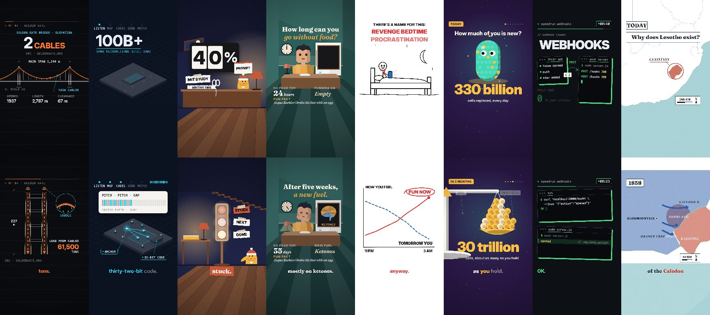

# Styles

A style is a look the writer designs a whole reel in, rather than a set of
scenes it fills. In a styled reel every scene, the opening too, is written as
code: a small React component that returns SVG, drawn every frame with the
scene's clock and its spoken words. The style gives the writer its feel, what
every reel in it keeps, and a whole reference video to remake for the new
story. The paper and studio looks and their scene catalog
(`src/scenes/SCENES.md`) are untouched; a reel is styled only when it asks.

```sh
npm run reel -- --url <https://…> --style map        # a new reel in a style
npm run style                                        # the styles and their reference videos
npm run style -- map                                 # a style's reference video as a test episode
npm run reel -- --episode episodes/_test-style-map --from voice
```

## The styles



| Id | Name | What it looks like | Reference video |
| --- | --- | --- | --- |
| `blueprint` | Blueprint HUD | Technical line art of the subject on a near-black blueprint grid, mono readouts, orange and cyan callouts | How the Golden Gate hangs its road |
| `diorama` | Lamplit diorama | Lamplit miniature dioramas, pebble characters in knit beanies, facts as split-flap counters and paper cards | Let AI draft your weekly update |
| `doodle` | Felt-tip doodle | Black felt-tip stick figures on a white page, a red pen circling the point | Why you stay up too late |
| `flat` | Flat vector | One flat-shaded hero object per scene floating on a plum night, a ladder of time or scale | How much of you is new today? |
| `isometric` | Isometric | Systems as small isometric worlds on deep navy, glowing paths between them | How Shazam hears your song |
| `map` | Moving map | A clean modern map the camera moves across, territory as colour, arrows that draw themselves | Why does Lesotho exist? |
| `terminal` | Terminal | A developer's screen late at night: panes, code that types itself, a countdown | Webhooks, against the clock |
| `timelapse` | Low-poly time-lapse | One low-poly room held by a fixed camera while a counter races and the room changes | How long can you go without food? |

A style is named after what it looks like, never what it's for or whose format
it follows: Lamplit diorama, not a coaching template; Terminal, not a speedrun
series. Each copies a format, never another creator's characters, title cards,
logos, palette or catchphrases: its characters and finish are its own, and its
`identity.never` list tells the writer what not to copy from its own reference.

## How a styled reel is made

| Step | What changes for a styled reel |
| --- | --- |
| seed | `episode.json` gets `"style": "<id>"` |
| write | The writer's instructions swap the scene catalog for the style (`src/styles/guide.mjs`): designing the reel, how to write a code scene, the opening, the best practices (`src/styles/best-practices.mjs`), and the style's feel, identity and reference video, scene by scene. Beat 1 is a `hook` with `title` and `source`; every other beat is a `code` scene with `source` and a `place` (the set it's in, never drawn). Logos it places are declared in a top-level `"logos"` list. |
| validate | Every scene is run and checked (`src/code/scene.mjs` `codeSceneErrors`): it runs at every frame, cues only words its line says, uses only media ids from `media.json` and declared logos, keeps its words inside the stage and out of the captions, big enough and readable against what's behind them, fills the stage, and never flashes. A scene after the opening whose drawing doesn't act on its words is warned (`codeSceneWarnings`, see "How scenes are designed"). Styled reels run longer: 6–10 beats and 70–135 words before the house CTA, about 30–55 s. |
| marks | Each declared logo's exact vector shapes are looked up (its SVG logo on Wikimedia Commons, as Wikidata names it, and its symbol from Simple Icons) into `marks.json`, cached in `.cache/marks/`; one that isn't found is set as its name. `marks.json` holds third-party logos, so it's never committed. |
| mix | The style's own sound (its `sound`, offered as the preset `<id>` in `src/audio/sound.mjs`), unless the episode sets its own `sound` |
| render, stills | The canvas look (`src/canvas.mjs`) instead of the paper or studio look |
| cover | The opening once it has settled, without captions |

## The canvas look

`src/canvas.mjs` draws only what every styled reel needs: the style's wall
colour, the spoken-word captions in the style's treatment in y 1300–1470, film
grain or a vignette when the style asks, and the closing ask (the house CTA's
keyword landing on a torn chip as it's said, with the brand's icon). Each
scene's code draws everything else on the whole 1080 × 1920 frame, at identity.
Kit isn't drawn: a style's characters are drawn in its scenes' code.

The style's palette (`primary`, `accent`, `ink`, `background`) becomes the
scenes' `colors`: `wall`, `floor` (a deeper wall), `ink`, `chalk` (cards),
`cardInk` (text on cards), `accent`, `rose` and `blush`.

## How scenes are designed

Whatever the style, a styled reel's scenes follow the best practices in
`src/styles/best-practices.mjs`: the writer reads them, the make-reel review
asks their questions of the finished reel, and `src/styles/guide.mjs` tells the
writer how to build them (designing the reel, the opening, writing a code
scene). The ones that decide how a scene is designed:

- **Objects act out the words.** Each scene after the opening is led by one big
  drawn thing (or the source media, or a logo) that does what its line says, on
  the word that names it: a heart tips a scale on "heart", a steak is flung off
  its plate on "meat", a calendar runs to week 6 and its page is torn off on
  "March". It changes state on its word (it moves, tips, flips, fills, swaps,
  gets flung or breaks) rather than only arriving, then settles. A number or a
  few words can land beside it, but when only text or a number changes on the
  word the scene is text-led: no text boxes, typed lines, stat boxes or labels,
  and no counter or gauge doing the work alone. Glyph art counts as an object
  only when its characters form a picture.
- **One material, one motion.** Everything drawn in a reel is made the same way
  (the style's fill, shadow side, highlight, outline and texture) and moves by
  one grammar (one ease, one entrance, one way of acting on a word), written as
  a small kit at the top of every scene's code.
- **The hook lands on its word.** The opening's title is on its first frame
  (the cover), and its key word lands big as it's said, within about the first
  two seconds: the reel's biggest move happens on that word. The opening is the
  one scene a word may lead.
- **A held payoff.** The line the reel builds to lands its final, biggest state
  on its word and holds it, still, for at least about a second. The closing ask
  cuts in as soon as that line ends, so the payoff lands about three words
  before its end.

The validator can tell one of these from the code. `codeSceneWarnings` runs
each scene after the opening twice on the same clock, once as its line is said
and once with none of its words said yet, so whatever runs on the clock alone (a
drift, a pulse, a loop, a hand-drawn jitter) is the same in both and only what
the words set off differs. When no shape or image differs, only words and
numbers, the scene is warned as text-led; when nothing differs, it's warned that
nothing lands on a word. It's a warning, not an error, and a floor: a card that
slides in under its number is drawing that moves, so the review still asks
whether an object acts out the line.

## Code scenes

A scene's `source` is one component:

```jsx
export default function Scene({ time, duration, colors, stage, words }) {
  const p = easeOut(clamp((time - at('free')) / 0.5));
  return <svg>…</svg>;
}
```

- **The interpreter** (`src/code/react-scene.mjs`) parses the source with
  `@babel/parser` and runs it itself: no `eval`, no modules but React, no
  browser, network, timers or prototype access, and a budget of operations per
  frame. A scene is a pure function of `time`.
- **Helpers**: `at('word')` (when a word of the line is said), `shot([...])`
  (cuts on words), `interpolate`, `clamp`, `ease`, `easeOut`, `easeInOut`,
  `easeOutBack`, `spring`, `range`, `torn` (a torn-paper outline), `asset('m01')`
  (a media item), `<Mark id="m80"/>` (a declared logo), and the map kit's
  `land()` and `geo()`.
- **The painter** (`src/code/paint.mjs`) draws the SVG elements on the canvas:
  shapes, paths, text with `width` wrapping and `maxLines` fitting, images,
  gradients, clip paths, transforms, opacity and `shadow`. It keeps every word
  readable: a word below WCAG contrast with what's behind it is drawn lighter
  or darker in its own hue until it reads.
- **Fonts**: `fontFamily` "sans" is Inter (Inter Display from 22 px up),
  "serif" is Fraunces, "mono" is the system's monospace.

## The map kit

`land('FR', x, y, w, h)` is a country's real outline as path data fitted in a
box; `land(['US', 'CA'], …)` puts several on one map, and `'*'` draws every
country a view shows. `geo(lon, lat, fit, x, y, w, h)` is a point on the same
map. Countries are ISO 3166-1 alpha-2 codes, projected in Web Mercator
(Antarctica from above the South Pole). The outlines are Natural Earth's 1:50m
admin-0 countries via the world-atlas 2.0.2 TopoJSON, generated into
`src/code/map/countries.mjs` (each country's box, all the checks need) and
`src/code/map/shapes.mjs` (the outlines, only the renderer loads them) by
`npm run map-kit` (`scripts/build-map-kit.mjs`, which downloads the pinned
files into `.cache/map-kit/` once). Natural Earth's borders are de facto ones
and imply no view on any dispute.

## Adding a style

A style is one folder, and being there registers it:

```
src/styles/<id>/
  style.mjs       default-exports the style (its id is the folder's name)
  reference.mjs   its reference video, when it doesn't fit in style.mjs
```

1. Name it after what it looks like (Lamplit diorama, Terminal), never what
   it's for or a creator, and give it a short id from that name for its folder:
   lowercase, one word (`diorama`, `terminal`).
2. Write `style.mjs` (see the `CanvasStyle` typedef in
   `src/styles/index.mjs`): its name, feel, identity, frame (caption
   treatment, grain, vignette), palette, sound (a bed, an effects set and their
   levels; `src/audio/sound.mjs` offers it as the preset `<id>`), a reference
   video (6–10 scenes, each with a label, a line, a place and its code, about
   45 s with the closing ask), and an opening and examples to design from.
3. `node --test test/styles.test.mjs`: every scene must pass the code checks
   and paint in Node, every scene after the opening of its reference video
   must act out its words (no `codeSceneWarnings`), its colours must read, and
   its reference video must validate as an episode.
4. `npm run style -- <id>`, voice and render it, and watch it.

Nothing else changes: the writer, the validator, the renderer, the cover, the
`--style` flag and the sound presets all read the registry.
